# 深地科学与人工智能中试基地建设进度看板

## 用户操作手册（培训版）

| 项目 | 内容 |
| --- | --- |
| 文档版本 | v1.0 |
| 日期 | 2026-11-23 |
| 适用对象 | 项目团队成员、项目管理员 |
| 配套文档 | `docs/PRD.md`、`README.md`、`DEPLOY.md` |
| 看板地址 | ________________________________ |
| 界面截图 | 以当前项目数据为例；实际数据以管理员发布为准 |

> **一句话理解**：团队成员打开网页看进度；管理员一个人负责更新进度并"发布"；只有发布后，团队才能看到最新数据。

---

## 目录

1. [手册说明](#1-手册说明)
2. [3 分钟快速上手](#2-3-分钟快速上手)
3. [页面总览](#3-页面总览)
4. [查看进度（团队成员）](#4-查看进度团队成员)
5. [管理员：日常更新](#5-管理员日常更新)
6. [Excel 导入与导出](#6-excel-导入与导出)
7. [发布更新](#7-发布更新)
8. [管理员设置](#8-管理员设置)
9. [常见问题 FAQ](#9-常见问题-faq)
10. [培训建议（讲师用）](#10-培训建议讲师用)
11. [管理员日常检查清单](#11-管理员日常检查清单)
12. [附录](#12-附录)
13. [v1.1 新版操作速查](#13-v11-新版操作速查)

> **阅读路径**：团队成员重点读第 2–4 章；管理员重点读第 5–8、11 章；培训讲师额外读第 10 章。

> **v1.1 更新（2026-11-23）**：新增责任人多选、序号自动/只读、部门/责任人候选表、重新编号、责任人筛选、Excel 9 列。旧的"8 列 / 手动序号 / 纯文本部门"描述以第 13 章为准。
>
> **v1.2 更新（2026-11-23）**：项目标题抽到根目录 `title.js`，管理设置中的标题改为只读。

---

## 1. 手册说明

### 1.1 目的

统一团队查看进度、更新进度、发布数据的方式，避免：

- 每个人手里的 Excel 版本不一致；
- 管理员改了进度，但团队看不到；
- 不知道"逾期""应启动未启动"是怎么判定的；
- 误操作覆盖数据。

### 1.2 两种角色

| 角色 | 能做什么 | 是否需要登录 |
| --- | --- | --- |
| 团队成员 | 查看整体进度、筛选部门/状态、查看任务详情、缩放、打印 | 不需要 |
| 项目管理员 | 团队成员的全部权限 + 修改进度、增删任务、调整阶段、导入/导出 Excel、发布 | 需要 |

> 系统只设置**一个管理员口令**，不区分多个账号。管理员口令由项目负责人单独告知，不要发到群里。

### 1.3 使用前提

- 电脑或手机浏览器：最新 Chrome、Edge、Safari、Firefox；不支持 IE。
- 打开项目负责人提供的看板地址；建议收藏到浏览器书签。
- 手机端可以查看和做简单编辑；**发布更新建议在电脑上完成**。

---

## 2. 3 分钟快速上手

### 2.1 团队成员：只看不改

1. 打开看板地址。
2. 先看顶部 4 个指标：整体完成率、任务状态、风险提示、计划周期。
3. 在工具栏按**责任部门**或**状态**筛选，或直接搜索任务名。
4. 点击任意任务行/卡片，查看起止时间、责任部门、进度和备注。
5. 用"日 / 周 / 月"切换时间尺度；默认"周"最适合日常查看。

### 2.2 管理员：改一条任务的进度

1. 在网址后加 `?admin=1`，点右上角"管理"；或连续点击页头 logo/标题 5 次。
2. 输入管理员口令。
3. 点击任务 → "编辑任务" → 调整"进度（%）" → "保存"。
4. 点顶部"发布" → "下载" `data.js` → 替换线上 `data.js` → 回到页面点"标记为已发布"。

> 保存只写入**本机草稿**；发布后团队才能看到。

### 2.3 最小操作路径速查

| 我想…… | 操作 |
| --- | --- |
| 看某部门的任务 | 工具栏 → 责任部门 → 勾选部门 |
| 看逾期/未启动任务 | 工具栏 → 状态 → 勾选"逾期"或"应启动未启动" |
| 看某条任务的详情 | 点击任务行/卡片 |
| 改一条任务的进度 | 登录 → 点任务 → 编辑任务 → 改进度 → 保存 → 发布 |
| 批量更新进度 | 改 Excel → 导入 Excel → 确认 → 发布 |
| 把最新进度发给团队 | 发布 → 下载 `data.js` → 替换线上文件 → 标记已发布 |
| 导出汇报表 | 登录 → 导出 Excel |
| 打印/导出 PDF | 工具栏右侧打印按钮 → 浏览器打印为 PDF |

---

## 3. 页面总览

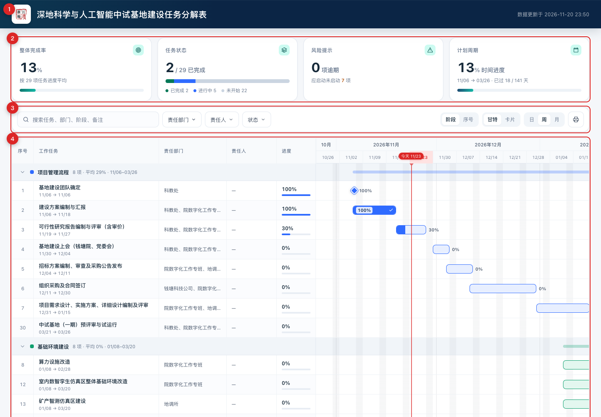

*图 1：桌面端页面总览。① 页头　② KPI　③ 工具栏　④ 甘特区*

### 3.1 页头（①）

- 左侧：项目 logo + 项目标题。
- 右侧：`数据更新于 YYYY-MM-DD HH:mm`，表示**最近一次发布**的时间，不是当前时间。
- 管理员入口是隐藏的：`?admin=1` 或连续点击 logo/标题 5 次。普通成员看不到"管理"按钮。

### 3.2 KPI 指标（②）

| 指标 | 含义 | 计算方式 |
| --- | --- | --- |
| 整体完成率 | 全部任务的平均完成度 | 所有任务进度相加 ÷ 任务数，四舍五入 |
| 任务状态 | 已完成 / 进行中 / 未开始 | 按进度 100 / 1–99 / 0 分组 |
| 风险提示 | 逾期数 + 应启动未启动数 | 见下方判定规则 |
| 计划周期 | 最早启动 → 最晚完成；时间进度 | 已过天数 ÷ 计划总天数 |

**风险判定：**

- **逾期**：今天 > 完成时间，且进度 < 100。
- **应启动未启动**：进度 = 0，今天 > 启动时间，且今天 ≤ 完成时间。
- 已完成的任务即使完成时间已过，也不标逾期（系统没有记录实际完成日期）。

> KPI 始终按**全部任务**计算，不受筛选影响。筛选后的数量显示在工具栏"筛选出 N 项"。

### 3.3 工具栏（③）

从左到右：

- **搜索**：任务名、责任部门、阶段、备注。
- **责任部门**：多选，按部门筛选；支持搜索。
- **责任人**：多选，按责任人筛选；支持搜索（v1.1 新增）。
- **状态**：未开始、进行中、已完成、逾期、应启动未启动。
- **清除筛选**：有筛选时出现。
- **阶段 / 序号**：按阶段分组，或按序号平铺。
- **甘特 / 卡片**：切换视图。
- **日 / 周 / 月**：时间轴缩放，默认周。
- **打印**：打印当前视图或导出 PDF。

### 3.4 甘特区（④）

- 左侧固定列：序号、工作任务（含起止日期）、责任部门、责任人、进度。
- 右侧时间轴：月份、周/日刻度、任务条、今天线。
- 每个阶段有一条**阶段汇总条**，显示该阶段的整体时间跨度。
- 任务条的颜色代表阶段；填充比例代表进度。
- 单日任务是**菱形里程碑**，不是一条短线。
- 红色竖线是**今天**。

### 3.5 页脚

显示"静态页面 · 数据由管理员发布后更新"，以及最近一次发布说明。

---

## 4. 查看进度（团队成员）

### 4.1 先看整体，再看局部

建议顺序：

1. **整体完成率**：项目大致走到哪一步。
2. **风险提示**：有没有逾期、应启动未启动。
3. **阶段**：哪个阶段拖后腿。
4. **具体任务**：点开详情看责任部门和备注。

图 1 中：整体 13%，0 项逾期，7 项应启动未启动，时间已过 16/141 天（11%）。说明**时间进度和完成进度大致同步**，但有多条任务已过启动时间仍未开始。

### 4.2 读懂任务条

| 视觉 | 含义 |
| --- | --- |
| 实心色条 + 勾 | 已完成（100%） |
| 部分填充的色条 | 进行中，填充比例 = 进度 |
| 空心/浅色描边条 | 未开始（0%） |
| 红色描边 | 逾期 |
| 琥珀色虚线描边 | 应启动未启动 |
| 菱形 | 单日任务（启动=完成） |
| 红色竖线 | 今天 |
| 阶段行的浅色长条 | 该阶段的最早启动–最晚完成 |

把鼠标放在任务条上会显示浮动提示；点击任务条或任务行会打开详情。

### 4.3 查看任务详情

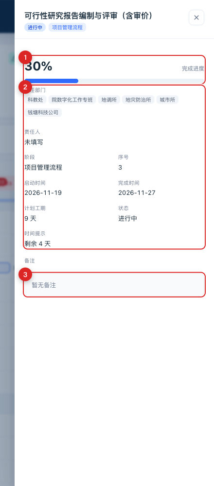

*图 2：任务详情抽屉。① 进度　② 任务字段　③ 备注*

点击任务行/卡片后，右侧（手机端为底部）弹出详情：

- 任务名称、状态、阶段；
- 责任部门、责任人；
- 启动时间、完成时间、计划工期；
- 当前状态：剩余天数 / 逾期天数 / 应启动未启动；
- 进度百分比；
- 备注。

管理员在详情底部会看到"编辑任务"按钮。

### 4.4 筛选任务

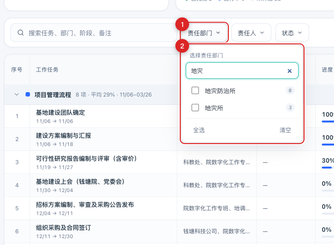

*图 3：责任部门筛选。① 筛选按钮　② 筛选面板*

1. 点"责任部门"、"责任人"或"状态"；
2. 在部门/责任人面板顶部可输入关键词过滤；
3. 勾选一个或多个条件；面板保持打开，可连续勾选；
4. 点"清除筛选"恢复全部。

**搜索**：在搜索框输入任务名、部门、责任人、阶段或备注关键词，列表实时过滤。

**分享筛选视图**：筛选条件会写入网址。例如把带 `?dept=地调所` 的链接发给同事，对方打开后自动看到同一筛选。

> "未开始"筛选包含所有进度为 0 的任务；"应启动未启动"是其中"已过启动时间"的子集；"逾期"按完成时间判断。

### 4.5 缩放、分组与折叠

- **日 / 周 / 月**：切换时间尺度。日视图适合看短期细节，月视图适合汇报。
- **阶段 / 序号**：
  - 阶段：按项目管理流程、基础环境建设等分组；
  - 序号：按序号平铺，适合核对 Excel 顺序。
- **折叠阶段**：点阶段名左侧的箭头，只保留阶段汇总行。

### 4.6 打印 / 导出 PDF

1. 点工具栏右侧的打印按钮；
2. 页面自动切换到"月视图 + 展开全部阶段"；
3. 在浏览器打印窗口选择"另存为 PDF"或直接打印；
4. 打印完成后页面自动恢复原状态。

打印样式为 A3 横向，包含页头、KPI 和完整甘特，隐藏筛选/管理按钮。

### 4.7 手机端

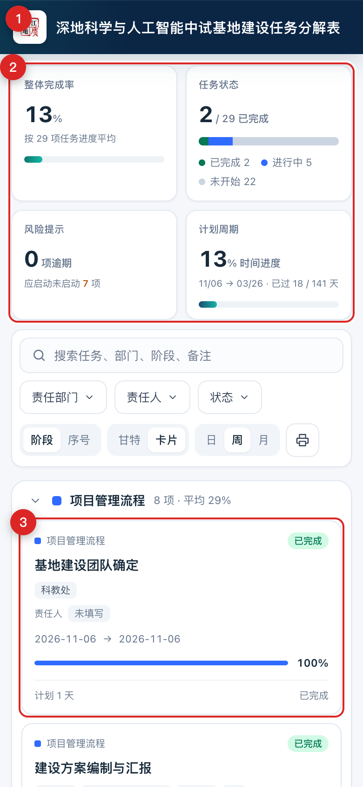

*图 4：手机端。① 页头　② KPI　③ 任务卡片*

- 手机默认显示**卡片视图**：每张卡显示任务名、部门、起止、进度、状态。
- 点卡片打开底部详情。
- 点工具栏"甘特"可切回时间轴；甘特需要左右滑动查看。

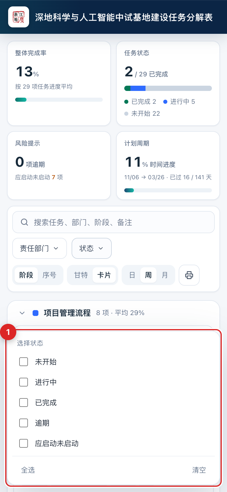

*图 5：手机端筛选面板*

筛选在手机端从底部弹出，勾选后点面板外区域关闭。

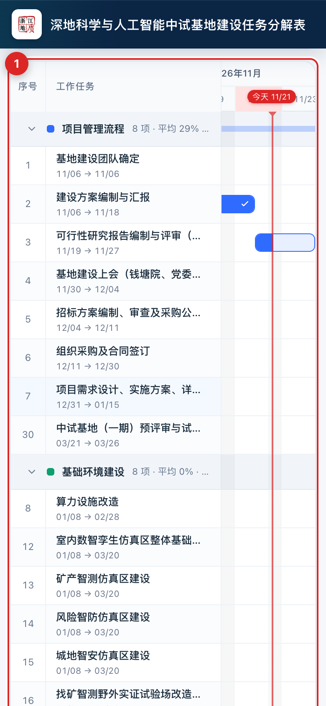

*图 6：手机端甘特视图*

> 手机端适合查看和简单改进度；**导入/导出 Excel、发布更新建议在电脑上做**。

---

## 5. 管理员：日常更新

### 5.1 登录

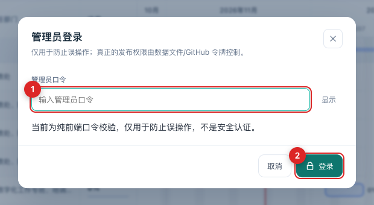

*图 7：管理员登录。① 输入口令　② 登录*

两种进入方式：

- 在网址后加 `?admin=1`，点右上角"管理"；
- 连续点击页头 logo/标题 5 次。

输入管理员口令。登录成功后：

- 顶部出现"退出管理"；
- 工具栏下方出现青绿色的**管理工具条**；
- 当前浏览器进入管理模式。

**会话**：关闭标签页后失效；刷新页面仍保持登录。
**锁定**：连续输错 5 次，锁定 30 秒。

> 纯前端口令只能防止误操作，不能防止懂技术的人绕过。真正的控制点是"谁有权替换线上 `data.js` / 谁持有 GitHub 发布令牌"。

### 5.2 管理工具条

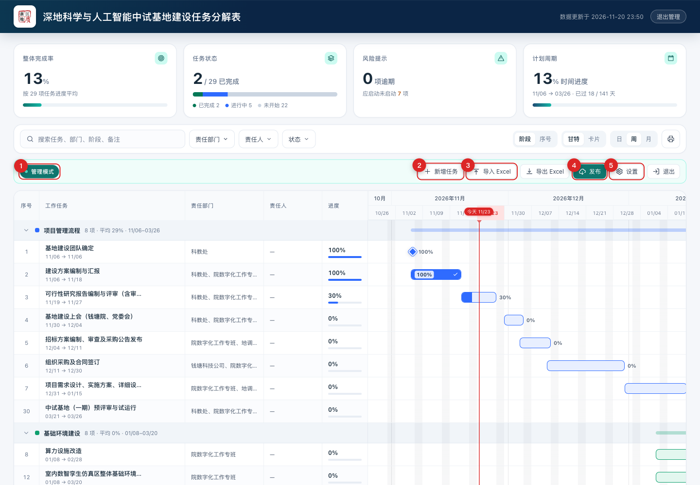

*图 8：管理工具条。① 管理模式　② 新增任务　③ 导入 Excel　④ 发布　⑤ 设置*

| 按钮 | 用途 |
| --- | --- |
| 新增任务 | 手工新增一条任务 |
| 导入 Excel | 用 Excel 批量覆盖任务 |
| 导出 Excel | 把当前数据导出为汇报用 Excel |
| 发布 | 生成发布文件 / GitHub 一键发布 |
| 设置 | 阶段、项目标题（只读）、GitHub、口令 |
| 退出 | 退出管理模式，草稿保留 |

有未发布修改时，工具条会出现橙色圆点和"有未发布修改"。

### 5.3 修改任务进度（最常用）

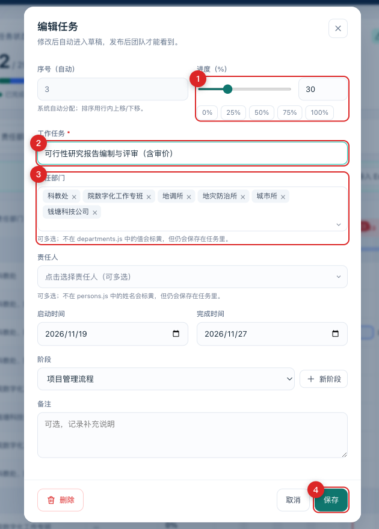

*图 9：编辑任务（v1.1 界面）。① 进度　② 任务名　③ 责任部门/责任人　④ 保存*

**方式一：详情编辑**

1. 点击任务行/卡片；
2. 点"编辑任务"；
3. 在"进度（%）"里拖动滑杆、输入数字，或点 `0% / 25% / 50% / 75% / 100%`；
4. 点"保存"。

**方式二：行内铅笔**

电脑端把鼠标移到任务行，点行末的铅笔图标，直接打开编辑框。

**进度语义：**

| 数值 | 状态 | 说明 |
| --- | --- | --- |
| 0 | 未开始 | 尚未启动 |
| 1–99 | 进行中 | 填写估算完成度 |
| 100 | 已完成 | 任务结束 |

保存后：

- 数据进入**本机草稿**；
- 页面立即显示新进度；
- 团队还看不到，直到你"发布"。

> **v1.1 提示**：责任部门、责任人已改为可搜索多选标签（支持表外值）；序号为自动分配且只读。详见 13.1 / 13.2。

### 5.4 新增任务

1. 管理工具条 → "新增任务"；
2. 序号由系统自动分配（只读）；填写任务名、责任部门、责任人、起止时间、进度、阶段、备注；
3. 点"保存"。

建议：

- 责任部门、责任人都可以多选；也可以输入表外值；
- 完成时间不能早于启动时间；
- 阶段从下拉框选择；没有合适的阶段可点"新阶段"。

### 5.5 编辑与删除

- 编辑：所有字段都可改，保存后进入草稿。
- 删除：打开编辑框 → 左下角"删除" → 确认。
- 删除不可撤销；重要任务建议先导出 Excel 备份。

### 5.6 调整任务顺序

电脑端把鼠标移到任务行，行末会出现 **上移 / 下移 / 编辑** 三个小按钮。

- 上移/下移会与相邻任务**交换序号**。
- 在"按序号平铺"视图里，顺序变化最直观。
- 在"按阶段分组"视图里，阶段内按**启动时间**排序，所以交换序号不一定改变行的位置；它主要影响同一天启动的任务，以及平铺视图。
- **v1.1 起序号只读**，不能在编辑框手改；需要整体整理时用"设置 → 数据 → 重新编号"。

### 5.7 阶段管理

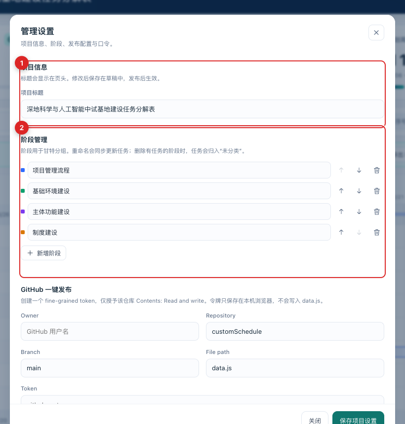

*图 10：管理设置。① 项目信息　② 阶段管理*

> 截图中的"项目标题"输入框现为**只读**；标题请在 `title.js` 修改（见 8.1、13.8）。

1. 管理工具条 → "设置"；
2. 在"阶段管理"里：
   - 直接在输入框改阶段名：保存后会**同步更新**该阶段下所有任务；
   - 用 ↑ ↓ 调整阶段顺序；
   - 点"新增阶段"添加；
   - 点垃圾桶删除；如果该阶段下还有任务，会提示这些任务移入"未分类"。
3. 点"保存项目设置"。

> 阶段顺序决定甘特图的分组顺序。建议保持：项目管理流程 → 基础环境建设 → 主体功能建设 → 制度建设。

### 5.8 草稿：保存了但团队没看到？

管理员的每次修改都会自动保存为本机草稿：

- 刷新页面、关闭标签页后再登录，草稿还在；
- 换电脑、换浏览器、清缓存后草稿不在；
- 草稿基于旧版本时，工具条会提示"线上数据已更新"；
- 发布成功后草稿自动清除；
- 手动下载发布文件后，需要点"标记为已发布"才清除草稿；
- 设置里可以"丢弃草稿并恢复线上数据"。

> 草稿只存在当前浏览器。**不要以为保存就等于发布。**

---

## 6. Excel 导入与导出

### 6.1 标准表格

模板：`templates/任务分解表模板.xlsx`

| 列 | 是否必填 | 说明 |
| --- | --- | --- |
| 序号 | 建议 | 显示序号；缺失会自动编号 |
| 工作任务 | 必填 | 任务名称 |
| 责任部门 | 建议 | 多个部门用顿号、逗号或分号分隔 |
| 责任人 | 可选 | 多个责任人用顿号、逗号或分号分隔；可留空 |
| 启动时间 | 必填 | `YYYY-MM-DD`，也支持 `2026/11/6`、`2026年11月6日` |
| 完成时间 | 必填 | 同上，不能早于启动时间 |
| 进度（%） | 建议 | 0 未开始；1–99 进行中；100 已完成 |
| 阶段 | 建议 | 用于甘特分组 |
| 备注 | 可选 | 显示在任务详情 |

说明：

- **责任人、备注列可以缺失**；如果连"阶段"列也没有，会把"备注"当作阶段（兼容旧模板）。
- 列顺序可以调整，系统按表头名称识别。
- 标准模板为 9 列；旧版 7/8 列表格仍可导入，责任人会留空。
- 只读取**第一张工作表**；表头上方可以有标题行。

### 6.2 导入 Excel

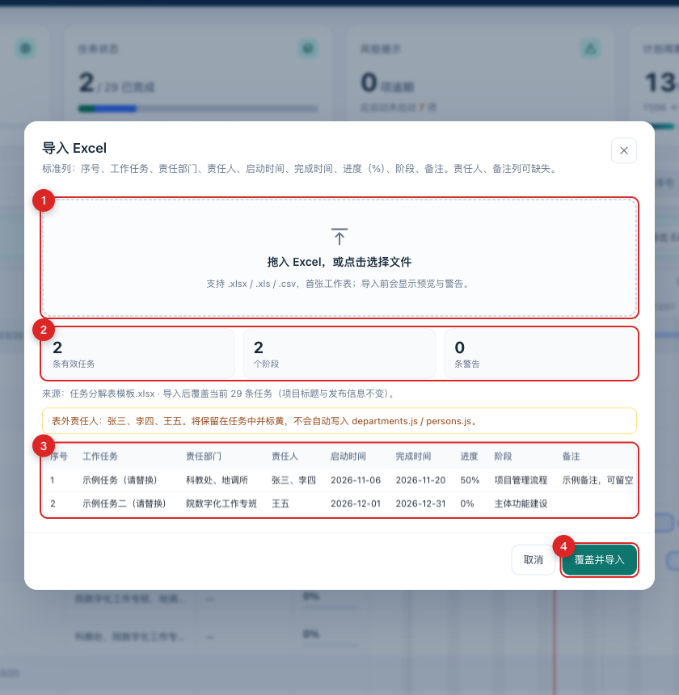

*图 11：导入 Excel。① 拖入/选择文件　② 统计　③ 预览　④ 确认导入*

1. 管理工具条 → "导入 Excel"；
2. 把 `.xlsx / .xls / .csv` 拖进虚线框，或点击选择文件；
3. 检查：
   - 有效任务数、阶段数、警告数；
   - 警告列表（例如序号为空、完成早于启动、进度超范围）；
   - 前 8 条预览；
4. 确认无误后点"覆盖并导入"。

**重要：**

- 导入会**覆盖当前全部任务**（项目标题和发布信息不变）；
- 有警告不会阻止导入，但请逐条核对；
- 如果一条有效任务都没有，导入按钮不可用；
- 导入后仍处于草稿状态，需要发布。

### 6.3 导出 Excel

1. 管理工具条 → "导出 Excel"；
2. 浏览器下载 `任务分解表-YYYY-MM-DD.xlsx`；
3. 文件包含"任务分解表"和"填写说明"两张工作表。

用途：

- 正式汇报；
- 导入前备份；
- 把当前网页数据交给不使用网页的同事。

> 导出是单向的：网页是数据源，Excel 只用于导入/导出，不建议两边同时改。

### 6.4 当前项目数据注意事项

截至 2026-11-23，建议管理员核对：

1. **源 Excel 当前是 8 列**（序号、任务、部门、启动、完成、进度、阶段、备注），没有"责任人"列；导入后责任人会为空。网页模板为 9 列，可在 Excel 中补"责任人"列后重新导入。
2. **网页当前数据**来自旧版 7 列导入，序号为 `1–28、30`；源表已更新为 `28、29`。若要同步，用"导入 Excel"或"重新编号"整理，二选一（导入会覆盖网页改动）。
3. **责任部门同时存在"地灾防治所"和"地灾所"**；部门表 `departments.js` 里两个都保留，由你决定是否合并。
4. 当前 29 条任务，整体完成率 13%，0 项逾期，7 项应启动未启动；责任人全部为空。
5. 部门表 `departments.js` 已按当前 8 个部门初始化；责任人表 `persons.js` 目前为空，需要你手工填写姓名。

### 6.5 复用到其他项目

1. 复制整个站点目录；
2. 用新项目 Excel 重新导入，或运行：
   `node tools/xlsx-to-data.js 新项目.xlsx data.js --title "新项目" --project-id "new-project"`
   命令行的 `--title` 只写入 `data.js` 元数据；页面显示标题以 `title.js` 为准。
3. 修改 `title.js` 的项目标题；修改 `config.js` 的 `projectId`、`logo`，替换管理员口令哈希；
4. 替换 `assets/logo.jpg`；
5. 部署到新地址。

---

## 7. 发布更新

### 7.1 为什么必须发布

页面读取的是线上 `data.js`。管理员在浏览器里改的是**本机草稿**，不发布的话：

- 管理员自己能看到；
- 团队看不到；
- 换浏览器/设备也看不到。

发布 = 把草稿变成新的 `data.js`，并替换线上文件。

### 7.2 手动发布（推荐先用这种方式）

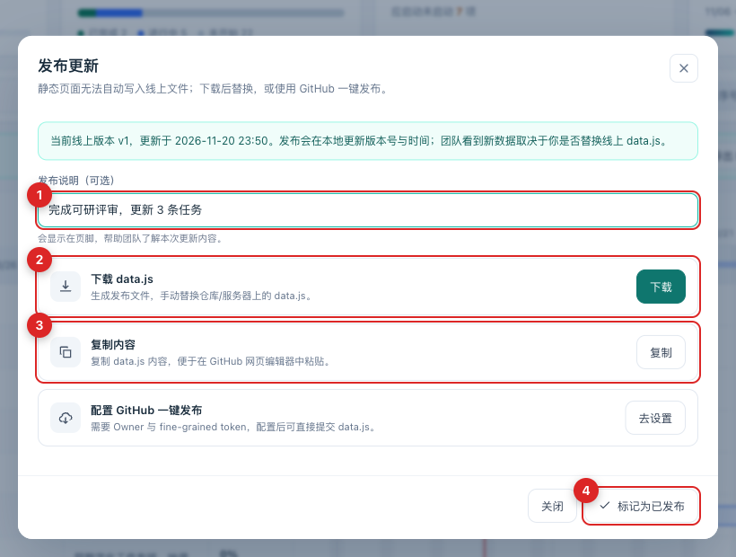

*图 12：发布更新。① 发布说明　② 下载　③ 复制内容　④ 标记为已发布*

1. 管理工具条 → "发布"；
2. 填写"发布说明"（可选，但建议写，例如"完成可研评审，更新 3 条任务"）；
3. 点"下载"，得到 `data.js`；
4. 替换线上文件：
   - **GitHub Pages**：仓库 → 根目录 `data.js` → 编辑/上传 → Commit；
   - **云服务器**：用 SFTP/控制台上传覆盖；
   - **共享盘/同步盘**：直接替换同名文件；
5. 回到页面，点 **"标记为已发布"**，清除本机草稿；
6. 让团队刷新页面（GitHub Pages 可能需要 1–2 分钟）。

> 下载后先不要急着点"标记为已发布"——确认线上文件已经替换成功再点。否则本地草稿被清除，但线上还是旧数据。

### 7.3 GitHub 一键发布

适合已经部署在 GitHub Pages、并且愿意配置令牌的场景。

**一次性配置：**

1. 打开 <https://github.com/settings/tokens?type=beta>；
2. 创建 fine-grained token：
   - Repository access：只选 `customSchedule`；
   - Permissions → Contents：`Read and write`；
   - 建议 90 天有效期；
3. 管理端 → 设置 → GitHub 一键发布：
   - Owner：GitHub 用户名
   - Repository：`customSchedule`
   - Branch：`main`
   - File path：`data.js`
   - Token：粘贴
   - 保存发布设置。

**每次发布：**

1. 管理工具条 → 发布；
2. 填写发布说明；
3. 点"一键发布"；
4. 看到"已发布到 GitHub"后，约 1 分钟 Pages 更新。

**令牌安全：**

- 只保存在当前浏览器 localStorage；
- 不会写入 `data.js`，不会进入仓库；
- 换电脑/清缓存后需要重新填写；
- 不要截图或发到群里。

### 7.4 发布后检查清单

- [ ] 页面"数据更新于"时间已变化；
- [ ] 版本号 +1；
- [ ] 关键任务的进度/日期正确；
- [ ] 团队任意一人刷新后能看到；
- [ ] 把本次 `data.js` 按日期备份（例如 `backup/data-2026-11-21.js`）。

### 7.5 版本与历史

- 每次发布会更新 `meta.updatedAt` 和 `meta.version`；
- 页面不自动保留历史版本；
- 需要回滚时，用之前备份的 `data.js` 覆盖线上文件，然后刷新。

---

## 8. 管理员设置

### 8.1 项目信息

项目标题统一由根目录 `title.js` 管理，页面设置中只读：

1. 编辑 `title.js` 里的 `window.PROJECT_TITLE = '...'`；
2. 刷新页面即可看到新标题；
3. 推送到线上后团队生效。

标题会同步用于页头、浏览器标签和发布后的 `data.js`；不需要在管理设置里修改。

### 8.2 阶段管理

见 5.7。重命名会同步任务；删除有任务的阶段会提示迁移到"未分类"。

### 8.3 GitHub 发布设置

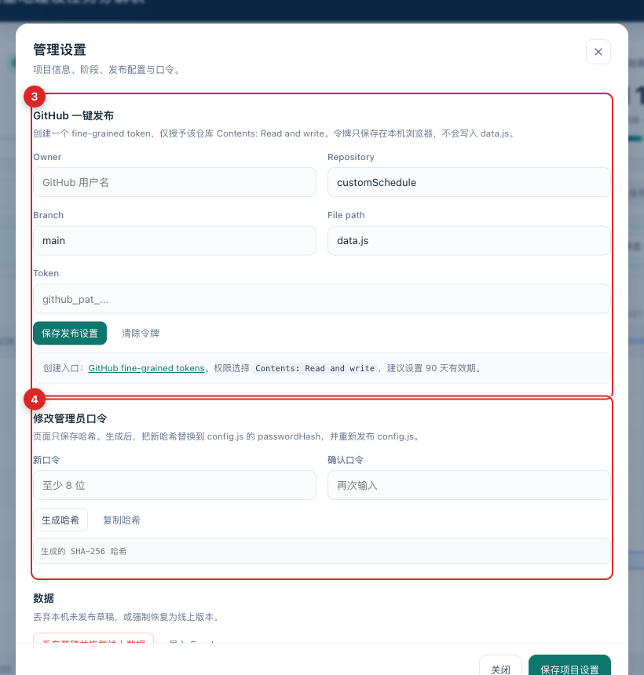

*图 13：设置中的 GitHub 与口令。③ GitHub 一键发布　④ 修改管理员口令*

见 7.3。修改后点"保存发布设置"。

### 8.4 修改管理员口令

1. 设置 → 修改管理员口令；
2. 输入新口令（至少 8 位）并确认；
3. 点"生成哈希"；
4. 复制生成的 SHA-256 哈希；
5. 打开 `config.js`，把 `passwordHash` 替换为新哈希；
6. 重新发布 `config.js`（推送到仓库/上传服务器）；
7. 退出管理，用新口令重新登录验证。

> **建议**：正式公开部署前更换一次口令。当前页面是纯静态的，口令哈希会随 `config.js` 公开；它只能防误操作，不能当真正的安全认证。

### 8.5 丢弃草稿 / 恢复线上数据

设置 → 数据 → "丢弃草稿并恢复线上数据"。

适用场景：

- 草稿改乱了；
- 线上数据已经被别人更新；
- 想重新从线上版本开始。

---

### 8.6 部门表、责任人表与重新编号

- 设置 → **部门表（departments.js）** / **责任人表（persons.js）**：
  - 只读展示表内值、表外值和使用次数；
  - "复制完整列表" / "复制表外值"生成 JS 数组，粘贴回文件；
  - 页面不会自动写文件。
- 设置 → 数据 → **"重新编号（预览）"**：
  - 按当前序号升序重编为 `1..N`；
  - 先预览，再确认；不会自动执行。
- 详细步骤见 13.3 / 13.5。

## 9. 常见问题 FAQ

**Q1：我改了进度，团队说看不到？**
A：保存只进入本机草稿。需要"发布"并替换线上 `data.js`，团队刷新后才能看到。

**Q2：刷新后我的修改没了？**
A：草稿保存在当前浏览器。换浏览器、换设备、清缓存会丢失。请及时发布。

**Q3：看不到"管理"入口？**
A：在网址后加 `?admin=1`；或连续点击页头 logo/标题 5 次。普通视图默认隐藏入口。

**Q4：忘记管理员口令怎么办？**
A：需要能修改 `config.js` 的人操作：
1. 用任意 SHA-256 工具生成新口令哈希，例如终端：
   `printf '%s' '新口令' | shasum -a 256`
2. 把 `config.js` 的 `passwordHash` 替换成结果；
3. 重新发布 `config.js`。
（页面内的哈希生成器需要先登录，忘密码时用不了。）

**Q5：导入 Excel 没反应/提示没有有效任务？**
A：检查：
- 是否第一张工作表；
- 表头是否有"工作任务""启动时间""完成时间"；
- 日期是否能识别；
- 是否所有行都缺任务名。
导入面板会列出具体警告和行号。

**Q6：为什么任务显示"逾期"或"应启动未启动"？**
A：
- 逾期：今天已超过完成时间，且进度 < 100；
- 应启动未启动：进度仍为 0，已超过启动时间，但还没到完成时间。
完成时间已过但进度 100，不会标逾期。

**Q7：为什么我上移/下移任务，行没有动？**
A：按阶段分组时，阶段内按启动时间排序；序号交换主要影响同一天启动的任务和"按序号平铺"视图。要看顺序变化，切到"序号"视图。

**Q8：GitHub 发布后页面没更新？**
A：Pages 有 1–2 分钟缓存。等待后强制刷新（Cmd/Ctrl+Shift+R）。如果还没更新，检查：
- 仓库里 `data.js` 是否真的变了；
- 发布是否成功；
- Branch/Path 是否填对。

**Q9：可以多人同时当管理员吗？**
A：系统只有一个口令，技术上多人可以登录，但草稿是**各自浏览器本地的**，容易互相覆盖。建议只指定一名管理员；确需多人时，约定"改前先刷新、改后立即发布"。

**Q10：口令安全吗？**
A：纯前端口令只能防误操作，不能防技术绕过。真正的控制点是发布权限（谁掌握线上文件/GitHub token）。不要把口令发到群里；公开部署前更换。

**Q11：手机上能改进度吗？**
A：可以：点卡片 → 编辑任务 → 改进度 → 保存。但导入/导出 Excel、发布建议在电脑上完成。

**Q12：页面能公网访问，数据会不会被搜到？**
A：页面有 `noindex` 和 `robots.txt`，但公网静态站点没有真正的访问控制；拿到链接的人都能看。不要主动传播链接；敏感项目建议部署到内网。

**Q13：怎么恢复上周的版本？**
A：系统不自动保留历史。管理员应定期把下载的 `data.js` 按日期备份；回滚时用备份覆盖线上文件。

**Q14：Excel 和网页以谁为准？**
A：**网页为唯一数据源**。Excel 只用于初始导入、批量更新和导出汇报；不要两边同时改。

---

**Q15：新增任务为什么拿到 29，而不是最大序号+1？**
A：v1.1 采用"最小空号"策略，会复用删除或历史遗留的空号。想让整表连续，用"设置 → 数据 → 重新编号"。

**Q16：部门/责任人后面有黄色"表外"是什么意思？**
A：这个值不在 `departments.js` / `persons.js` 的候选表里；它仍会保存在任务和 `data.js` 中。要让它成为正式候选，把值补进对应文件并推送。

**Q17：怎么新增一个部门或责任人？**
A：直接编辑 `departments.js` / `persons.js` 里的数组，提交/推送后刷新页面；设置里的只读表可以复制当前列表/表外值，方便粘贴。

**Q18：责任人可以填多个吗？**
A：可以；在任务编辑器里多选，Excel 里用顿号分隔。甘特列显示 `张三、李四`。

## 10. 培训建议（讲师用）

### 10.1 培训目标

培训结束后，学员应能：

- 独立打开看板，读懂 KPI 和甘特条；
- 用部门/状态筛选找到自己的任务；
- 管理员能独立完成"改进度 → 保存 → 发布 → 验证"闭环；
- 知道草稿和线上数据的区别；
- 知道哪些数据问题需要回到 Excel 修正。

### 10.2 30 分钟议程

| 时间 | 内容 | 方式 |
| --- | --- | --- |
| 0–5 分钟 | 背景、角色、看板地址 | 讲解 |
| 5–15 分钟 | 团队成员视角：KPI、甘特、筛选、详情 | 演示 + 学员操作 |
| 15–25 分钟 | 管理员视角：登录、改进度、草稿、发布 | 演示 + 学员操作 |
| 25–28 分钟 | Excel 导入/导出、数据规范 | 讲解 |
| 28–30 分钟 | 常见问题、答疑 | 讨论 |

### 10.3 演示脚本（可照着点）

**团队成员部分：**

1. 打开看板，指出页头更新时间。
2. 指出整体完成率、风险提示。
3. 点"责任部门"→ 勾选"地调所"→ 指出筛选结果数量。
4. 点击"可行性研究报告编制与评审"→ 展示详情。
5. 切换"日 / 周 / 月"。
6. 点打印按钮 → 展示打印预览（不实际打印）。

**管理员部分：**

1. 网址加 `?admin=1` → 点"管理" → 输入口令。
2. 找到"基地建设上会"→ 编辑 → 指出序号自动且只读；在责任部门/责任人里搜索并选择 → 进度从 0 改成 30 → 保存。
3. 指出工具条"有未发布修改"。
4. 点"发布"→ 填写说明 → 下载 `data.js`（演示下载，不实际替换）。
5. 点"标记为已发布"（演示清除草稿）。
6. 演示"设置 → 阶段管理"的改名/排序；再展示部门表/责任人表（只读）和重新编号预览（不确认）。
7. 演示"导入 Excel"的 9 列预览、表外责任人提示（不点确认）。

> 培训时不要使用真实管理员口令投屏；建议临时改一个演示口令，培训后换回。

### 10.4 学员练习

**练习 A（团队成员）：**

1. 筛选"地调所"的任务，数一数有几条；
2. 找出所有"应启动未启动"的任务；
3. 打开任意任务详情，说出它的责任部门和计划工期；
4. 把当前视图打印/导出为 PDF。

**练习 B（管理员，在测试环境）：**

1. 把某条任务进度改为 50%；
2. 新增一条"培训测试任务"，给部门/责任人各选一个（或输入表外值），保存；
3. 指出序号自动生成且只读；打开"重新编号"预览（不确认）；
4. 发布到测试目录，让另一位同事刷新验证；
5. 删除测试任务，再次发布。

### 10.5 培训前检查清单

- [ ] 看板地址可访问（电脑 + 手机各试一次）；
- [ ] 管理员账号可登录；
- [ ] 准备一份测试数据/测试目录，避免培训时污染正式数据；
- [ ] 投屏分辨率足够看清甘特图；
- [ ] 准备一份当前 `data.js` 备份；
- [ ] 如果演示 GitHub 一键发布，提前配置测试 token；
- [ ] 提醒学员不要在现场修改正式进度。

### 10.6 培训后跟进

- 把本手册和看板地址发给团队；
- 指定唯一管理员，并在群里公布"每周五更新、发布"的节奏；
- 一周后收集问题，更新 FAQ；
- 一个月后检查：是否还在用旧 Excel、是否有未发布草稿、口令/token 是否到期。

---

## 11. 管理员日常检查清单

### 每日 / 每次更新

- [ ] 打开看板，确认"数据更新于"是最近时间；
- [ ] 检查"逾期"和"应启动未启动"；
- [ ] 更新自己负责的任务进度；
- [ ] 保存后立即发布；
- [ ] 让一位团队成员刷新确认。

### 每周

- [ ] 核对各阶段完成率是否与实际情况一致；
- [ ] 检查责任部门名称是否统一；
- [ ] 备份当前 `data.js`；
- [ ] 清理已完成但不再需要展示的任务（可选）。

### 每月

- [ ] 检查管理员口令是否需要更换；
- [ ] 检查 GitHub token 有效期；
- [ ] 回顾阶段划分是否仍适用；
- [ ] 导出一次 Excel 作为月度归档。

---

## 12. 附录

### 12.1 数据填写速查

| 项目 | 规范 |
| --- | --- |
| 日期 | `YYYY-MM-DD`；也支持 `2026/11/6`、`2026年11月6日` |
| 进度 | 0–100 整数；0 未开始，1–99 进行中，100 已完成 |
| 责任部门 | 多个部门用 `、` `，` `,` `；` `;` 分隔 |
| 责任人 | 多个姓名用 `、` `，` `,` `；` `;` 分隔；可留空 |
| 阶段 | 建议固定 4 类：项目管理流程、基础环境建设、主体功能建设、制度建设 |
| 序号 | 新增自动分配；编辑时只读；可用"重新编号"整理 |
| 备注 | 可选；显示在任务详情 |

### 12.2 浏览器与地址

| 场景 | 地址 |
| --- | --- |
| 本地预览 | 双击 `index.html`，或 `http://127.0.0.1:8765/` |
| 管理员入口 | 看板地址后加 `?admin=1` |
| 带筛选分享 | 例如 `?dept=地调所&status=late`、`?owner=张三` |
| GitHub Pages | `https://<用户名>.github.io/customSchedule/` |

### 12.3 术语表

| 术语 | 含义 |
| --- | --- |
| 草稿 | 管理员本机浏览器里的未发布修改 |
| 发布 | 生成新的 `data.js` 并替换线上文件 |
| 阶段 | 任务分组，例如"项目管理流程" |
| 里程碑 | 启动时间 = 完成时间的单日任务 |
| 逾期 | 超过完成时间且未完成 |
| 应启动未启动 | 已过启动时间但进度仍为 0，且未到完成时间 |
| 时间进度 | 已过天数 ÷ 计划总天数 |

### 12.4 维护者文件地图

| 文件 | 作用 |
| --- | --- |
| `index.html` | 页面入口 |
| `styles.css` | 视觉样式、响应式、打印 |
| `title.js` | 项目标题（唯一来源，换项目只改这里） |
| `config.js` | 项目 ID、logo、管理员哈希、GitHub 默认值；标题仅作旧版回退 |
| `data.js` | 当前发布的任务数据 |
| `departments.js` | 部门候选表（只读，手工维护） |
| `persons.js` | 责任人候选表（只读，手工维护） |
| `js/` | 应用逻辑（工具、甘特、渲染、选择器、管理、发布、启动） |
| `shared/parse.js` | Excel 解析（浏览器/Node 共用） |
| `tools/` | Excel 转 data.js、模板生成、解析测试 |
| `templates/` | 空白 Excel 模板 |
| `README.md` / `DEPLOY.md` | 使用与部署说明 |

---

## 13. 新版操作速查（v1.1 / v1.2）

> 本章覆盖 2026-11-23 的新功能（含 v1.2 标题文件化）；前文旧的"8 列 / 手动序号 / 纯文本部门 / 页面内改标题"描述以本章为准。

### 13.1 新增任务：序号自动

- 点"新增任务"后，**序号由系统自动分配**，取当前最小空号；例如现有 `1–28、30` 时，新任务会拿到 **29**。
- 序号输入框是**只读**的，不需要手填。
- 删除任务后空号会保留；下一条新任务可以复用该空号。
- 要让整表连续（例如把 `1–28、30` 变成 `1–29`）：
  1. 设置 → 数据 → **"重新编号（预览）"**；
  2. 查看"旧号 → 新号"预览；
  3. 点"确认重新编号"；只有确认后才会写入草稿。

### 13.2 部门 / 责任人选择器

任务编辑框里的"责任部门"和"责任人"都改成了**可搜索多选标签**：

1. 点击字段，弹出选择面板（电脑下拉，手机底部面板）；
2. 输入关键词过滤；点击选项加入/取消；
3. 支持一次粘贴多个值（用 `、，,；;` 分隔）；
4. 输入不存在的部门/姓名，按回车可"使用 XXX（不在表）"；
5. 已选值显示为标签，点标签上的 × 移除；
6. 点"完成"关闭面板。

- 责任部门候选来自 `departments.js` + 任务里已用到的表外部门；
- 责任人候选来自 `persons.js` + 任务里已用到的表外姓名；
- 候选人旁的数字是当前任务数；黄色"表外"表示不在候选文件里。

### 13.3 部门表 / 责任人表怎么维护

- 文件位置：站点根目录的 `departments.js`、`persons.js`；
- 页面**只读**，不会自动写文件；
- 新增/改名/删除：直接编辑文件里的数组，提交/推送后刷新页面；
- 设置 → 部门表/责任人表 可以只读查看表内/表外值和使用次数；
- 点"复制完整列表"或"复制表外值"，把生成的 JS 数组粘贴回文件；
- 表外值会随任务保存在 `data.js`，一键发布会带上，但不会自动进入候选文件。

### 13.4 责任人显示与筛选

- 甘特左侧新增独立 **"责任人"** 列，多个责任人显示为 `张三、李四`，超长省略，悬停看全；
- 卡片、详情、打印、Excel 都包含责任人；
- 顶部筛选栏新增 **"责任人"**，支持搜索/多选，只列出当前任务实际用到的责任人；
- 筛选条件写入 URL，例如 `?owner=张三`；
- 责任人不是必填项，留空显示"未填写"。

### 13.5 重新编号

- 入口：设置 → 数据 → "重新编号（预览）"；
- 按当前序号升序，把全部任务重编为 `1..N`；
- 筛选中的隐藏任务也会被重编；
- 预览会标出会变化的行；
- **不会自动执行**；点"确认重新编号"后才写入草稿；
- 只改显示序号，不改任务 ID；
- 当前数据不会自动重编，需要你手动点一次。

### 13.6 Excel 9 列

新模板为：

```
序号 | 工作任务 | 责任部门 | 责任人 | 启动时间 | 完成时间 | 进度（%） | 阶段 | 备注
```

- 责任人列可缺失；多个责任人用顿号分隔；
- 导入时表外的部门/责任人会提示，但不会阻断；
- 导出会自动带上责任人列。

### 13.7 发布注意

- 一键发布仍然**只提交 `data.js`**；
- `title.js` / `departments.js` / `persons.js` 修改后需要单独提交/推送；
- 表外值在 `data.js` 里，一键发布会带上，但要成为正式候选仍需补进文件；
- 口令哈希在 `config.js`，也不在一键发布范围内。

### 13.8 项目标题

- 标题唯一来源：根目录 `title.js` 的 `window.PROJECT_TITLE`；
- 修改后刷新页面生效，推送后团队生效；文件按时间戳加载，通常无需强刷；
- 页头、浏览器标签、管理设置、发布后的 `data.js` 都使用该标题；
- 管理设置里的标题为只读，不需要在页面里改。

---

> **培训结束前，请记住三句话：**
>
> 1. 团队成员看网页，不看 Excel 附件。
> 2. 管理员改完必须**发布**，团队才能看到。
> 3. 草稿在本机，发布才共享。